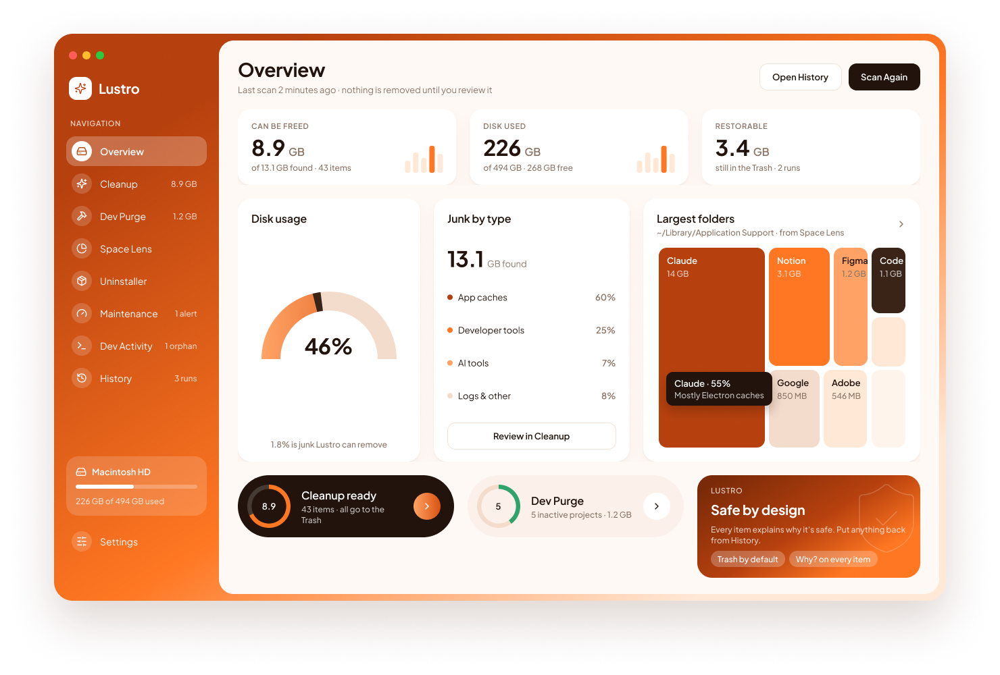
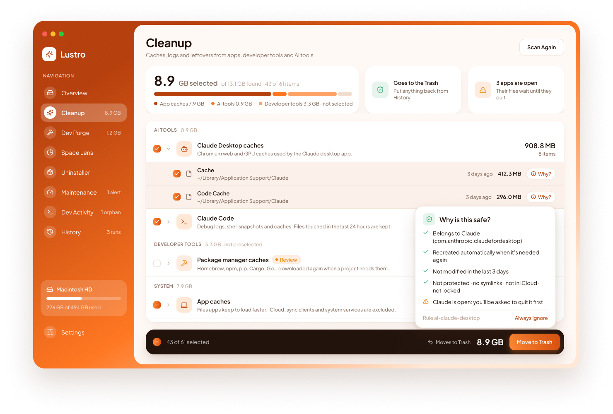
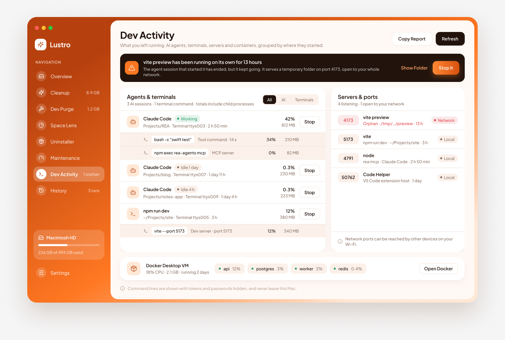
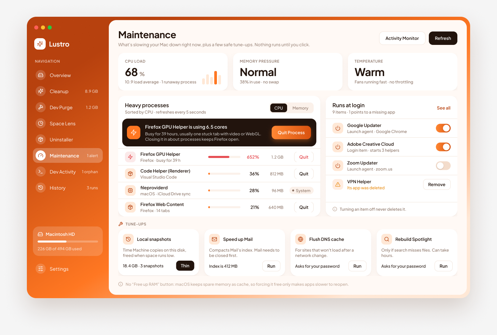

<p align="center"></p>

<h1 align="center">Lustro</h1>

<p align="center">A free, open-source Mac cleaner that shows you exactly what it removes.<br>
Native SwiftUI · no network access · no telemetry · moves to Trash by default · light and dark · English and Portuguese.</p>

<p align="center"><a href="#português">Português</a></p>

<p align="center"></p>

<table>
  <tr>
    <td></td>
    <td></td>
    <td></td>
  </tr>
  <tr>
    <td align="center">Cleanup</td>
    <td align="center">Dev Activity</td>
    <td align="center">Maintenance</td>
  </tr>
</table>

---

## What it does

| Module | What it finds |
|---|---|
| **Overview** | A dashboard of what can be freed, disk usage, junk by type, your largest folders and what can still be restored. |
| **Cleanup** | App caches and logs, Xcode Derived Data, package-manager caches (Homebrew, npm, Yarn, pip, Cargo, Go…), editor caches, leftovers from AI tools (Claude Code, Claude Desktop, Codex, Gemini CLI, Cursor, OpenCode), local AI models, iOS update files and backups, installers in Downloads, and the Trash. |
| **Dev Purge** | `node_modules`, `target`, `.venv`, `.next`, `build`, `DerivedData` and ~40 other regenerable folders inside your projects. Projects you haven't touched in 30 days are preselected. |
| **Space Lens** | A treemap and sorted list of what takes up space in any folder. Browse in, select, remove. |
| **Uninstaller** | Removes an app together with its preferences, caches, containers, saved state and launch agents. |
| **Maintenance** | Live CPU, memory pressure and temperature; the processes using the most CPU or memory, with a plain-language alert when one runs away (and a safe way to quit it); the launch agents that start on their own, with on/off switches; and four tune-ups: thin Time Machine snapshots, compact Mail's index, flush the DNS cache and rebuild Spotlight. |
| **Dev Activity** | What you left running, grouped by where it started: AI agent sessions (Claude Code, Codex, Gemini CLI, Cursor Agent, Aider, OpenCode…) with everything they spawned (MCP servers, tool commands, sub-agents), commands running in each terminal, servers started by apps, and **orphans**: dev servers and tools that kept running after their terminal or session ended. Also every listening port (flagging ones open to your network) and the Docker/OrbStack/Colima VM with per-container usage. Command lines are shown with secrets hidden. |
| **History** | Every removal, with one-click restore for items still in the Trash. |

### Why there's no "Free up RAM"

macOS uses spare memory as a cache for files and apps you're likely to open again. "RAM cleaners" work by grabbing memory until the system throws that cache away, so the number looks better for a moment and apps are slower to reopen afterwards. Lustro shows **memory pressure** instead, which is what tells you whether your Mac is actually short of memory. When a Mac gets slow or loud, the cause is almost always one process using too much CPU, and that's what the Maintenance screen points out.

## Safety first

Cleaning tools delete things. Lustro is designed so that a mistake is hard to make and easy to undo:

- **Trash by default.** Everything goes to the Trash unless you switch to permanent deletion in Settings.
- **Review before removing.** Nothing is removed without a confirmation that shows the item count and size. Every item has a **Why?** button that lists the checks it passed (owner app, age, rule, protections), and can be revealed in Finder or ignored forever.
- **Undo from History.** Every run is recorded on your Mac. Items still in the Trash can be put back where they were with one click.
- **Open apps are respected.** Files of apps that are running are held back until you quit them (Lustro can quit and reopen them for you).
- **Dry run mode** shows what would be removed without touching anything.
- **Protected locations.** Your home folder, Documents, Desktop, `~/Library` itself, `/System`, `/usr` and similar folders are never removed. Keychains, SSH keys, Mail, Messages, Safari, Photos and iCloud Drive are never touched at any depth.
- **Re-validated at removal time.** Each path is checked again right before removal. Symlinks are never followed, so a link can't redirect a removal outside the allowed folders. Locked, SIP-protected and iCloud-only files are skipped, never force-unlocked.
- **Proof before purge.** Dev Purge only flags a folder when a project file proves what it is: `node_modules` needs a `package.json` beside it, and `target` needs `Cargo.toml`, `pom.xml` or `build.sbt`. A random folder called `build` in your notes is left alone.
- **Active work is left alone.** Temporary files of AI tools touched in the last 24 hours are skipped, so running sessions aren't broken.
- **Exact matching in the uninstaller.** Leftovers are matched by exact bundle identifier, never by fuzzy name guessing. Apple apps are not listed.
- **Caution items are never preselected,** for example Xcode archives, iPhone backups and local AI models.
- **Processes are asked, not killed.** Quitting a process sends it a normal quit request (apps get to ask about unsaved work); Force Quit is offered only if it doesn't respond within 10 seconds. macOS processes and other users' processes can't be quit from Lustro.
- **Launch agents are switched off, not deleted.** Turning one off uses launchd's own disabled list, so it can be turned back on at any time. Only agents whose app is gone can be removed, and they go to the Trash and into History.
- **Command lines are redacted, best effort.** Tokens, passwords, API keys and credentials in URLs are masked before anything is shown or copied. Not every secret can be recognised, so read a copied report before sharing it publicly.
- **Tune-ups that change data ask first.** Removing local Time Machine snapshots (they are backups) and compacting Mail's index both need a confirmation. Mail's index is cloned before it's compacted and only discarded once the result passes SQLite's integrity check.
- **Admin tasks use the standard password prompt.** Flushing DNS and rebuilding Spotlight run through macOS's own authorisation dialog; Lustro doesn't install a privileged helper.

## Privacy

Lustro makes **no network requests**. It has no analytics, no crash reporter, no remote configuration and no account. Your settings live in `~/Library/Application Support/Lustro/settings.json`.

## Install

### Download

1. Get `Lustro.zip` from [Releases](../../releases) and move `Lustro.app` to `/Applications`.
2. Releases are not notarized by Apple yet, so macOS will block the first launch. Allow it once:
   ```sh
   xattr -dr com.apple.quarantine /Applications/Lustro.app
   ```
   Alternatively, try to open it, then go to **System Settings → Privacy & Security** and click **Open Anyway**.

### Build from source

Requires macOS 14+ and a recent Xcode (Swift 6).

```sh
git clone https://github.com/guiboorges/lustro.git
cd lustro
scripts/build-app.sh        # creates build/Lustro.app
open build/Lustro.app
```

Run the tests with `swift test`.

Local builds are signed ad-hoc, so macOS asks for permissions such as Full Disk Access again after each rebuild. This is on purpose: a self-signed identity that `codesign` can use without a password would let any program in your account sign itself as Lustro and inherit its permissions.

### Full Disk Access (optional)

Some categories live in protected folders: sandboxed app caches, Mail downloads and iPhone backups. To include them, add Lustro under **System Settings → Privacy & Security → Full Disk Access**. Without it, those categories are skipped instead of flooding you with permission prompts.

## Translations

Lustro is available in English, Brazilian Portuguese and European Portuguese. Translations live in `Localization/<language>.json`, keyed by the English text exactly as it appears in the code (including `%@` and `%lld` placeholders). `scripts/build-localization.py` turns them into `.strings` files when the app is built, and `scripts/check-localization.sh` lists anything missing or unused; CI runs it on every pull request. To add a language, copy `pt-BR.json`, translate the values and add the language code to `CFBundleLocalizations` in `scripts/build-app.sh`.

## Adding cleaning rules

Cleanup rules live in [`Sources/LustroCore/Resources/rules.json`](Sources/LustroCore/Resources/rules.json), so you can add support for an app without writing Swift. See [CONTRIBUTING.md](CONTRIBUTING.md).

## Project layout

```
Sources/LustroCore   scanning, safety policy and removal (no UI; fully tested)
Sources/Lustro       SwiftUI app
Tests               unit tests, run against a throwaway fake home folder
scripts             app bundle and icon builders
```

## Credits

- Typeface: [Plus Jakarta Sans](https://github.com/tokotype/PlusJakartaSans) by Tokotype, bundled under the SIL Open Font License 1.1 (`Resources/Fonts/OFL.txt`).
- Icons: SF Symbols (macOS).

## Disclaimer

Lustro is an independent project and is not affiliated with any commercial Mac cleaner. Use it at your own risk; the defaults are conservative, but always review what you remove. Licensed under the [MIT License](LICENSE).

---

## Português

**Lustro** é um limpador para Mac gratuito e de código aberto que mostra exatamente o que vai remover. A interface está em português (do Brasil ou de Portugal, conforme o sistema) e tem tema claro e escuro. É uma app nativa em SwiftUI, não faz ligações à rede, não tem telemetria e manda tudo para o Lixo por omissão.

- **Limpeza:** caches e logs de apps, Xcode, gestores de pacotes, editores e ferramentas de IA (Claude Code, Codex, Cursor…), atualizações e backups de iOS, instaladores e o Lixo.
- **Dev Purge:** `node_modules`, `target`, `.venv`, `.next` e outros artefactos de projetos que podem ser reconstruídos. Só aparecem quando existe um ficheiro de projeto que prove o que são.
- **Space Lens:** mapa do que ocupa espaço numa pasta.
- **Desinstalador:** remove apps juntamente com os ficheiros de suporte, que são encontrados pelo bundle ID exato.
- **Dev Activity:** o que ficou a correr, agrupado pela origem: sessões de agentes de IA (Claude Code, Codex, Gemini CLI…) com os processos que lançaram, comandos em cada terminal, servidores abertos por apps e processos órfãos (servidores que continuaram depois de o terminal ou a sessão acabar). Mostra também as portas abertas (com aviso quando estão expostas à rede) e a VM do Docker. As linhas de comando aparecem sem segredos.
- **Manutenção:** CPU, pressão de memória e temperatura em tempo real; os processos mais pesados, com um alerta quando um fica descontrolado; os launch agents que arrancam sozinhos, com interruptor; e quatro tune-ups (snapshots do Time Machine, índice do Mail, cache de DNS e Spotlight). Não há "libertar RAM" de propósito: o macOS usa a memória livre como cache, e forçá-la a ficar livre só torna as apps mais lentas a reabrir.

**Segurança:**
- vai para o Lixo por omissão e tem modo de simulação;
- há pastas protegidas que nunca são apagadas;
- cada caminho volta a ser validado antes de ser removido;
- nunca segue links simbólicos;
- os itens de risco nunca vêm pré-selecionados.

**Privacidade:** zero pedidos de rede, sem analytics nem configuração remota.

**Instalar:** descarrega `Lustro.zip` em [Releases](../../releases). Depois, corre `xattr -dr com.apple.quarantine /Applications/Lustro.app`, ou compila tu mesmo com `scripts/build-app.sh`.

**Contribuir:** as regras de limpeza estão em `rules.json`. Vê o [CONTRIBUTING.md](CONTRIBUTING.md).
